# DSH IDE Tools

IDE-style plugins for [DeepSeek Harness](https://github.com/deepseek-ai/deepseek-harness) — Code, Git, Terminal, Containers, Database, Browser, Downloads, Scheduled tasks, SSH workspaces, file sidebar, split view, Lite mode, and more.

Requires a running DeepSeek Harness with **Plugins**. This repo is the plugin suite, not Harness itself.

## Install

1. Open **Plugins** in the left sidebar.
2. Click **Add plugin**.
3. Paste this URL and click **Install**:

```text
https://github.com/1nsaint/DSH-IDE-Tools
```

(Shorthand: `github:1nsaint/DSH-IDE-Tools`.)

4. Wait for pnpm to finish, then **hard-refresh** the browser (Ctrl+Shift+R).
5. Open **Settings** for host-specific bits (LLM / Ollama URL, Browser CDP, metrics, search keys, SSH). Those live in `$DSH_HOME/plugins-data/` and are **not** shipped by the suite.

<p align="center">
  
</p>

<p align="center">
  
</p>

The suite installs as one package (`dsh-ide-tools`). Uninstall that row to remove everything.

**One plugin only:**

```text
github:1nsaint/DSH-IDE-Tools#path:plugins/dsh-browser
```

**Notes**

- Not on npm yet — paste the GitHub URL, not bare `dsh-ide-tools`.
- Optional headed Chromium for Remote Browser is a separate Docker companion — see **Settings → Browser** after install.

More detail: [`docs/INSTALL.md`](docs/INSTALL.md) · [`docs/FAQ.md`](docs/FAQ.md)

## Features

### Overview

<p align="center">
  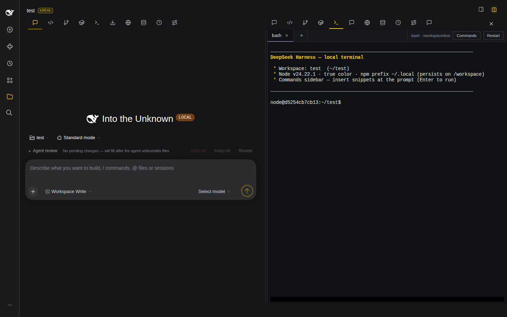
</p>

### Code

Center editor — find-in-file, edit, download; open from the file sidebar or chat links.

<p align="center">
  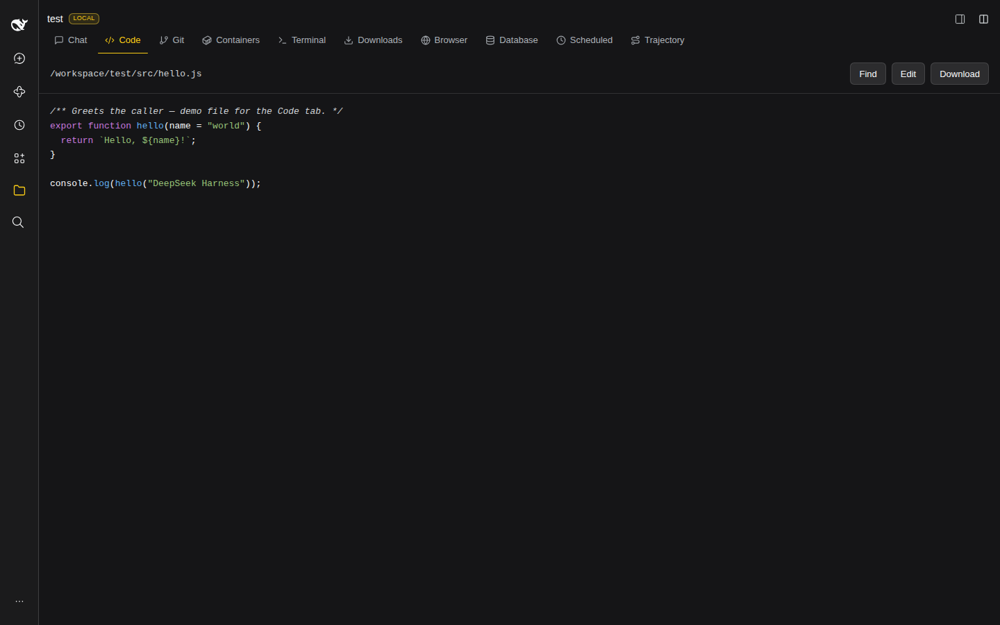
</p>

### Git

Branches, changes, history, clone/publish, GitHub sign-in.

<p align="center">
  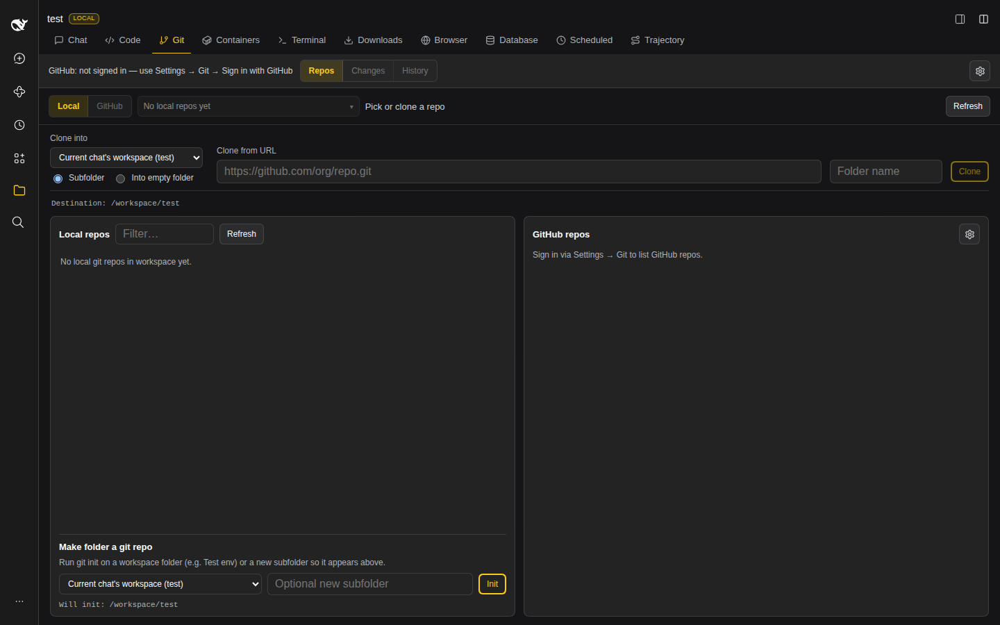
</p>

### Terminal

Interactive PTY (local or via SSH workspaces).

<p align="center">
  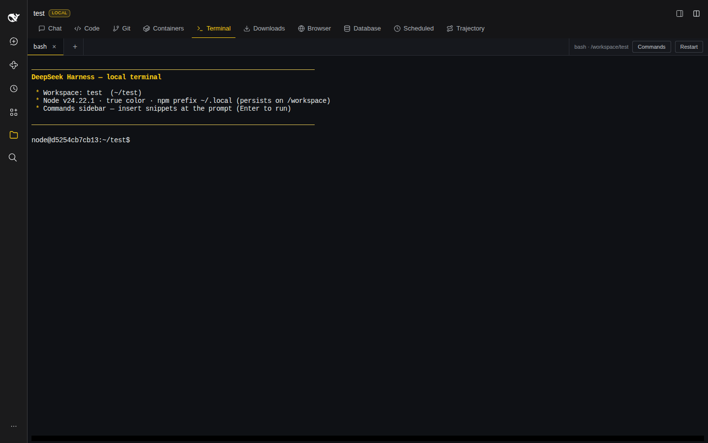
</p>

### Downloads

Aria2 — magnets, torrents, large HTTP; agent tools included.

<p align="center">
  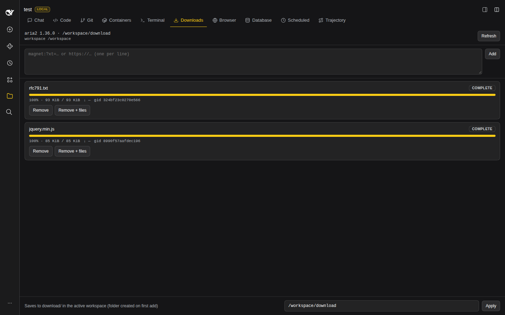
</p>

### Browser

Live in-app browser + optional Remote Chromium (CDP).

<p align="center">
  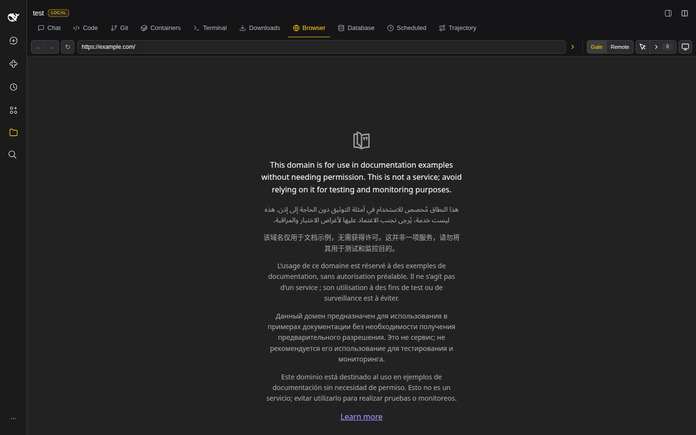
</p>

### Database

Multi-engine explorer — connections, table search, optional SQL.

<p align="center">
  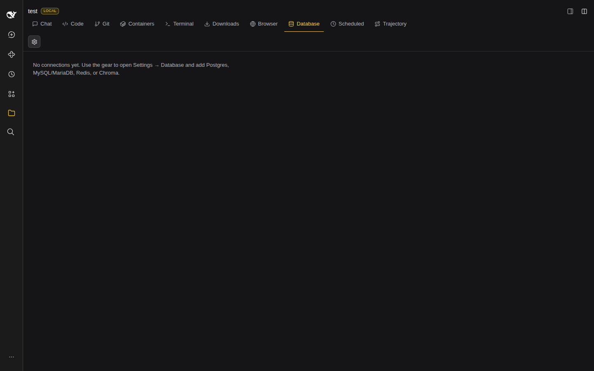
</p>

### Scheduled

Durable cron → fresh Automation sessions.

<p align="center">
  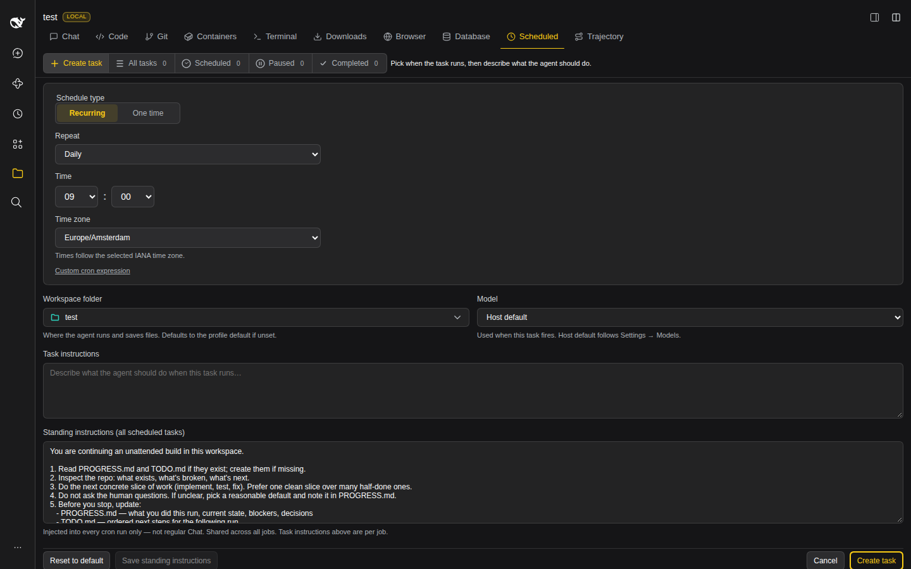
</p>

### Containers

Docker list — filters, logs, ports, remotes.

<p align="center">
  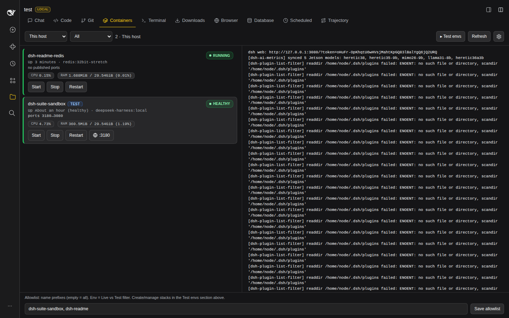
</p>

### Split view

Side-by-side panes; Terminal gets its own PTY in the split surface.

<p align="center">
  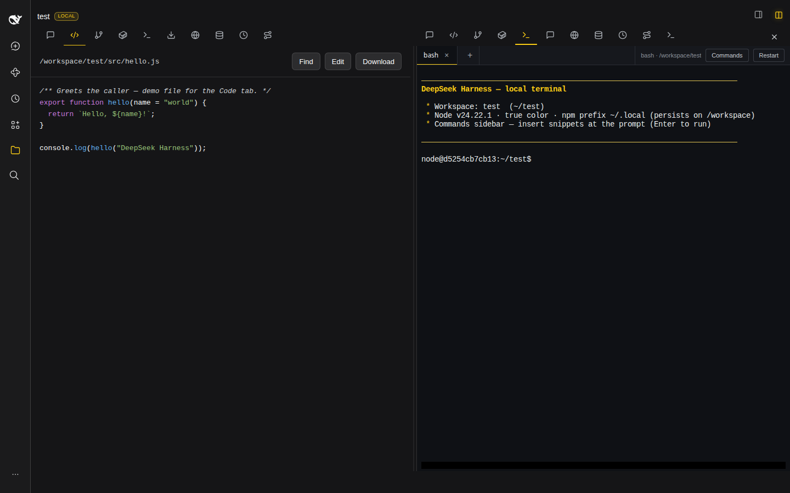
</p>

### SSH

Settings → **SSH** — saved hosts, keys, remote folders, `dssh://` workspaces, SFTP + SSH terminal.

<p align="center">
  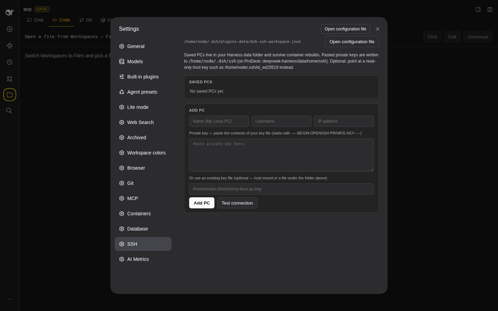
</p>

### Also included

| Area | What it does |
| --- | --- |
| **File sidebar** | Workspaces ↔ Files tree, search, drag paths into chat |
| **Lite mode** | Settings profiles that trim agent tool categories for small/local GPUs |
| **Agent review** | Cursor-style review of agent file edits — undo / keep / diff |
| **Live write** | “Writing…” card while write/edit tool args stream |
| **MCP** | Settings UI to add stdio / HTTP MCP servers |
| **AI Metrics** | Sidebar RAM donut + optional metrics / Ollama proxies |
| **Workspace accents** | Per-workspace color accents |
| **Archived** | Restore or permanently delete archived chats |
| **Web search router** | Provider routing for search tools |
| **UI / settings polish** | Wider chat, settings icons, remote Settings unlock helpers |
| **Local agent** | KV / context tweaks aimed at local models |
| **Composer dock** | Steps / tokens / context under the composer |

## License

MIT — see [`LICENSE`](LICENSE). Third-party plugins retain their own licenses; see [`CREDITS.md`](CREDITS.md).
