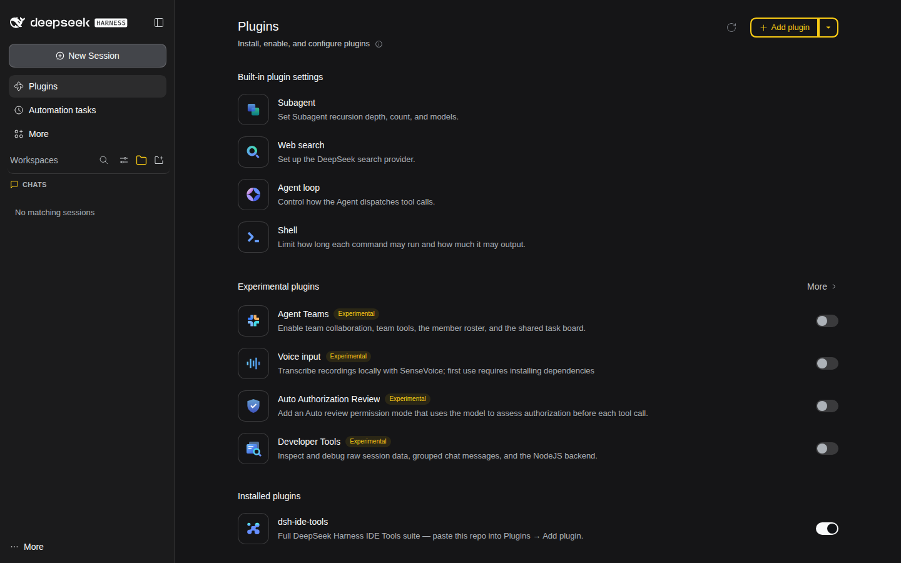
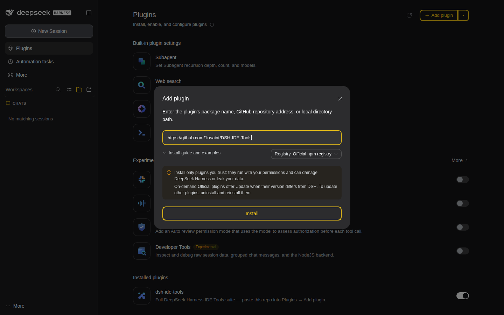

# DSH IDE Tools

IDE-style plugins for [DeepSeek Harness](https://github.com/deepseek-ai/deepseek-harness) — Code, Git, Terminal, Containers, Database, Browser, Scheduled tasks, files sidebar, workspaces, and more.

## Install

1. Open **Plugins** in the left sidebar.
2. Click **Add plugin**.
3. Paste this URL and click **Install**:

```text
https://github.com/1nsaint/DSH-IDE-Tools
```

(Shorthand: `github:1nsaint/DSH-IDE-Tools`.)

4. Wait for pnpm to finish, then **hard-refresh** the browser (Ctrl+Shift+R).
5. Open **Settings** for host-specific bits (LLM URL, Browser CDP, metrics, search keys). Those live in `$DSH_HOME/plugins-data/` and are **not** shipped by the suite.

<p align="center">
  
</p>

<p align="center">
  
</p>

The suite installs as one package (`dsh-ide-tools`). Uninstall that row to remove everything.

**One plugin only:**

```text
github:1nsaint/DSH-IDE-Tools#path:plugins/dsh-browser
```

**Notes**

- Not on npm yet — paste the GitHub URL, not bare `dsh-ide-tools`.
- Optional headed Chromium for Remote Browser is a separate Docker companion — see **Settings → Browser** after install.

More detail: [`docs/INSTALL.md`](docs/INSTALL.md) · [`docs/FAQ.md`](docs/FAQ.md)

## License

MIT — see [`LICENSE`](LICENSE). Third-party plugins retain their own licenses; see [`CREDITS.md`](CREDITS.md).
